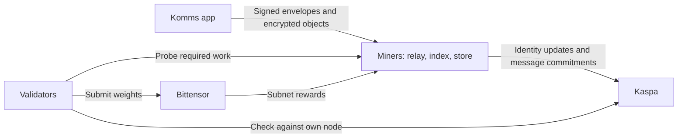

# Komms

Komms is building private messaging for teams and communities, with user-held
identities on Kaspa and a Bittensor subnet for the operators who deliver,
index and store the work.

[Website](https://komms-landing-landing-page.up.railway.app/) ·
[Subnet 27 on Taostats](https://taostats.io/subnets/27/) ·
[Network status](docs/network/network-status.md) ·
[Whitepaper and papers](docs/network/papers.md)

> **Development stage:** Komms is preparing its public beta. The recorded
> deployment is on Kaspa Testnet 10 and Bittensor testnet subnet 503.
> Investors hold the owner key for Bittensor mainnet netuid 27, and a control
> proof was accepted on 25 October 2026. The Komms mechanism is not claimed
> to be operating there; ownership does not establish weight publication or
> operator payments.
> [Current status and launch gates](docs/network/network-status.md).

## The product and its demand

Komms Business serves teams in a workspace; Komms Community serves communities
in a server. The planned product combines channels, direct messages and files,
with passkey sign-in and pricing per workspace or server rather than per seat.
Private message bodies are encrypted on the user's device.

Product activity creates the infrastructure workload: relays deliver signed
messages, indexers track identity and anchoring state, and storage operators
retain encrypted objects. Kaspa records identity changes and message
commitments. The message body stays off chain.

The first release focuses on messaging. Calls, mobile apps, developer services
and proving are separate roadmap stages. See the [product guides](docs/README.md)
and [roadmap](docs/network/roadmap.md).

## What the subnet is designed to measure

Miners provide services. Validators check their work against their own Kaspa
node and run known-answer journeys, retrieval checks and sponsorship audits.
The required probe set determines which capabilities earn score. A capability
that has no required measurement earns no score.

The current qualification stage is index-first. Store, serve and v4 relay
scoring require their own activation and acceptance evidence; a role in the
architecture diagram is not evidence that its scoring is live.

This is the target service model. Deployment and qualification are recorded in
[Network status](docs/network/network-status.md), with operator roles and
limits in [Mining](docs/mining-and-validating/mining.md) and
[Validating](docs/mining-and-validating/validating.md).

## Rewards, costs and customer revenue

The launch design separates three flows:

- **Subnet rewards:** Bittensor distributes native rewards using validator
  weights. Fees, message volume and wallet balances are not score inputs.
- **Audited cost repayment:** operators front eligible Kaspa fees from their
  own wallets. The planned operator programme repays accepted claims in alpha
  from a separately funded pot, within audited limits.
- **Customer revenue:** subscriptions fund service costs and the operator
  program. The adopted funding policy allocates 25% of the previous month's
  gross revenue to operator-program alpha purchases.

An alpha purchase is not subscription revenue or a native emission payment.
The repayment programme is a launch design, not an operating payment history.
Read [Incentives and funding](docs/network/incentives.md) for the mechanism,
controls and remaining acceptance work.

## Review the network

| Question | Start here |
| --- | --- |
| What is deployed and what still has to pass? | [Network status](docs/network/network-status.md) |
| How do delivery, identities and anchors fit together? | [How Komms works](docs/network/how-komms-works.md) |
| What is measured, planned or not yet demonstrated? | [Evidence and claim boundaries](docs/network/evidence.md) |
| Which services and keys remain team-operated? | [Operating responsibilities](docs/network/what-we-run.md) |
| What can operators and chain observers see? | [Privacy boundaries](docs/security-and-privacy/what-others-can-see.md) |
| What does the longer-term thesis cover? | [Whitepaper and papers](docs/network/papers.md) |
| How can an operator participate? | [Mining](docs/mining-and-validating/mining.md) and [validating](docs/mining-and-validating/validating.md) |
| How will people use the app? | [All guides](docs/README.md) |

## Contact and contributions

Contact [info@komms.app](mailto:info@komms.app) for operator onboarding,
technical questions or investor materials. Documentation corrections are
welcome through [issues and pull requests](CONTRIBUTING.md). Report security
vulnerabilities through the private route in [SECURITY.md](SECURITY.md).

The documentation and papers are licensed under [CC BY-SA 4.0](LICENSE).
The Komms name and logo remain trademarks; see [NOTICE](NOTICE).
